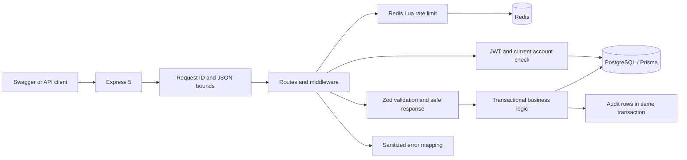
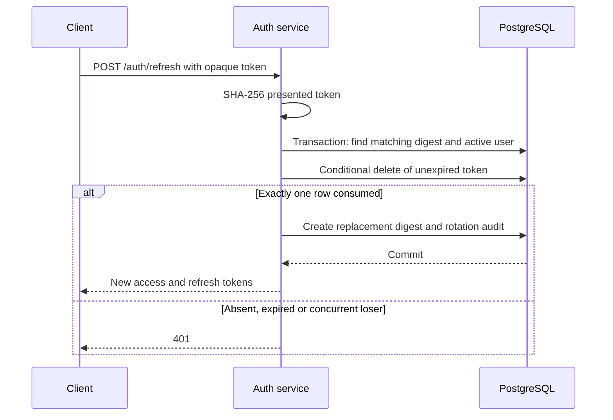

# Architecture And Implementation Walkthrough

## Request Flow

`app.ts` constructs the Express application without opening an HTTP listener; Supertest can exercise it in-process. `index.ts` owns environment validation, listening and shutdown. Configuration is loaded before Prisma/Redis construction; neither needs a successful connection merely to import the application.

Request context comes before JSON parsing so malformed and oversized bodies also have a server-generated correlation ID. Helmet/CORS/HPP apply before routes. Controllers parse Zod schemas and translate HTTP inputs; services implement database policy. There is no extra repository layer because Prisma already supplies the narrow query boundary used by tests.

## Signup And Login

Signup validates email/password, hashes the password with bcrypt cost 12, and creates the USER and audit event in one database transaction. A failed audit insert rolls back the user creation. A unique email conflict becomes 409. Clients cannot select ADMIN through signup. The controller returns only the user's id and email, not the service's internal Prisma row.

Login finds a non-deleted account and verifies bcrypt. Wrong passwords and nonexistent emails return the same 401 message; this is not a constant-time account-enumeration defense. Successful login writes a refresh-token digest and audit events transactionally, then returns raw tokens once. Password hashing protects low-entropy human passwords with deliberate computational cost; SHA-256 is appropriate for high-entropy random refresh tokens, not a replacement for bcrypt passwords.

## Access And Authorization

JWTs have a 15-minute expiry, HS256 signature, issuer `auth-service` and audience `auth-service-api`. Verification restricts the algorithm and requires a positive integer user id, a valid role value and an expiry claim. Signature validity alone is insufficient: every protected request queries the active account and uses its **current database role**.

This gives immediate denial on the next request after deletion or demotion, rather than waiting for JWT expiry. The cost is a DB query per protected request and dependency on DB availability. `/me` then retrieves only id, email, role and creation time. `/profile` intentionally retains the older authorization-context shape, not an exact profile alias.

## Refresh Rotation

The conditional delete count is the concurrency decision. Two requests may initially read the same token, but only one can consume it; the other must not mint another valid session. Creation and audit failures roll back the consumption. Random refresh tokens contain 32 bytes of entropy, encoded as base64url. The DB contains only the indexed digest and expiry, never the raw replacement token.

The migration hashes existing token strings before renaming the column/index, preserving the existing clients' tokens and expiry. It does not retroactively erase old database backups. Replay returns 401 without revoking the winner's replacement; family tracking is outside this milestone. Each refresh extends expiry by seven days, with no separate absolute session lifetime.

Logout accepts the presented token without an access JWT, removes its digest if present and records `SESSION_LOGOUT` only when a row is consumed. Repeats return 204. It does not blacklist access JWTs or revoke other login sessions.

## User Listing And Rate Limits

User listing uses explicit Prisma projections and active-account filtering. It orders by `(createdAt DESC, id DESC)`, fetches `limit + 1`, returns only `limit` records and supplies the last returned id as `nextCursor` when more remain. The id resolves the timestamp tie in the cursor query. The client passes the cursor back unchanged. Concurrent deletion of the cursor row or changes to sort fields are not snapshot-consistent; a signed timestamp/id cursor would be a future improvement.

Redis executes `INCR`, TTL inspection and missing-expiry repair in one Lua operation. Keys include the interpreted client IP and mounted route. Fixed windows are simple and shared across API replicas, but do not implement per-account lockouts, distributed bot detection or a global signup quota. Redis failure closes these auth routes with 503.

## Lifecycle And Evidence

Liveness does not query stores. Readiness checks both stores and returns a generic 503 on failure, with bounded client connection/command settings. The runtime image uses readiness for its Docker health check. SIGTERM/SIGINT stop accepting HTTP, allow in-flight work to finish, disconnect stores and impose a 10-second upper bound.

Unit tests control store boundaries; real-store tests prove HTTP contracts, password/hash handling, role changes, soft deletion, one-time/concurrent rotation, logout isolation, audit payloads, tied-timestamp pagination and Redis expiry behavior. CI runs these against disposable services. Test success is evidence for these cases, not proof of production safety, performance or comprehensive lifecycle coverage.